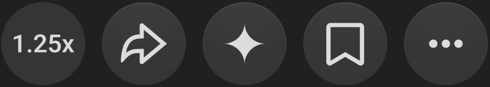
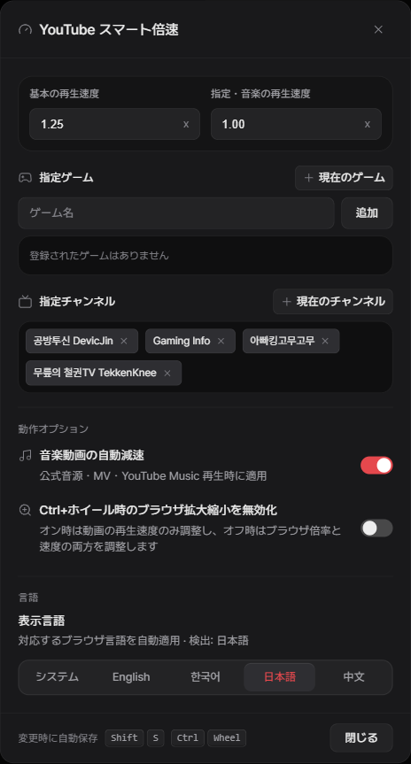

[🇺🇸 English](./README.md) · [🇰🇷 한국어](./README.ko.md) · **🇯🇵 日本語** · [🇨🇳 简体中文](./README.zh-CN.md)

# YouTube スマート倍速

**YouTube Smart Speed**

チャンネル・ゲーム・音楽の条件に応じて YouTube の再生速度を自動で切り替え、`Ctrl + ホイール` による微調整とブラウザズームのブロック切り替えに対応するユーザースクリプトです。

  
  
  

## プレビュー

  
<strong>プレーヤーアクションバー統合ボタン</strong>

  
    
  
<strong>設定画面（ダークテーマ）</strong>

  

## 主な機能

### 条件別の自動倍速

- **即時の自動切り替え**: 通常の動画は基本速度（既定 `1.25x`）、登録したゲーム・チャンネル・音楽動画は指定速度（既定 `1.00x`）へ、視聴ページ（`/watch`・`/live/*`・`/shorts/*`）および YouTube Music で待ち時間なく即時に切り替えます。
- **ワンクリック登録**: 動画の視聴中に `+ 現在のゲーム` または `+ 現在のチャンネル` を押すだけで一覧に追加でき、多言語ゲーム別名（日・英・韓・中）と単語境界判定で誤検出を抑えます。
- **音楽動画の自動減速** (`デフォルト: ON`): YouTube Music、ミックス再生リスト（`list=RD`）、トピック音源、公式アーティストチャンネル、音楽カード、公式音源・MV（エンターテイメントカテゴリ含む）再生時に自動で指定速度を適用します。

### Ctrl+ホイール制御

- **再生速度の微調整**: 視聴ページ（`/watch`、`/live/*`、`/shorts/*`）や YouTube Music で `Ctrl` + マウスホイールにより `0.25x` 刻みで速度を変更できます。手動変更は次の動画に切り替わるまで維持されます。
- **Ctrl+ホイール時のブラウザ拡大縮小を無効化** (`デフォルト: OFF`): オフの既定状態ではブラウザのズームと動画速度の両方が調整されます。オンにするとブラウザの拡大・縮小をブロックし、動画の再生速度のみを調整します。

### 設定画面と言語

- **アクションバーの倍速ボタン**（`1.25x`）、**拡張機能メニューの「設定」**、または <kbd>Shift</kbd> + <kbd>S</kbd> からいつでも設定を開け、変更内容は即時に自動保存・反映されます。
- YouTube のライト/ダークテーマに自動で追従し、全画面表示中でもモーダルが隠れません。
- ブラウザ言語から日本語・英語・韓国語・中国語を自動選択し（未対応言語は英語が既定）、モーダル内のボタンで `システム` / `English` / `한국어` / `日本語` / `中文` を即座に切り替えられます。

## インストール方法

1. ブラウザに [Tampermonkey](https://www.tampermonkey.net/) または [Violentmonkey](https://violentmonkey.github.io/) をインストールします。
2. 下の **Install UserScript** ボタンをクリックしてスクリプトをインストールします:

   

     
   

3. 拡張機能の確認画面で **インストール** を押し、YouTube のタブを再読み込みします。
4. アクションバーの倍速ボタン、拡張機能メニューの **設定**、または <kbd>Shift</kbd> + <kbd>S</kbd> から好みに合わせて調整してください。

手動インストールと自動更新について

- ワンクリックインストール画面が開かない場合は、[`youtube-smart-speed.user.js`](./youtube-smart-speed.user.js) の内容をコピーして拡張機能の新規スクリプトに貼り付けて保存してください。
- ヘッダーに `@updateURL` と `@downloadURL` を設定しているため、今後のアップデートは拡張機能側から自動確認されます。

## ショートカット

| 操作 | ショートカット |
| --- | --- |
| 設定画面を開く / 閉じる | <kbd>Shift</kbd> + <kbd>S</kbd> |
| 再生速度を上げる / 下げる（`0.25x` 単位） | <kbd>Ctrl</kbd> + <kbd>Wheel</kbd> |
| 設定画面を閉じる | <kbd>Esc</kbd> |

## 技術仕様と互換性メモ

- 設定は `GM_getValue` と `GM_setValue`（`localStorage` フォールバック付き）に保存され、`v1.0.0` の `localStorage` 設定を自動移行するため `www.youtube.com` と `music.youtube.com` 間で設定が共有されます。
- `@run-at document-start` で起動し、`yt-player-updated`・`yt-navigate-finish`・初期メディアイベントに即座に反応し、現在の動画 ID と一致する `playerResponse`・`watchNext` のみを検証して使用します（Firefox の XrayWrapper および DOM フォールバック対応）。
- 設定保存時にチャンネル・ゲームマッチャーを事前コンパイルし、最新の `videoAttributesSectionViewModel`・`horizontalCardListRenderer` を常時監視オブザーバーなしで高速参照します。
- スタイルと設定 UI は `innerHTML` を使わず DOM API と `textContent` のみで生成しているため、YouTube の Trusted Types CSP 環境でもブロックされません。

## ライセンス

[MIT License](./LICENSE) の下で公開されています。
