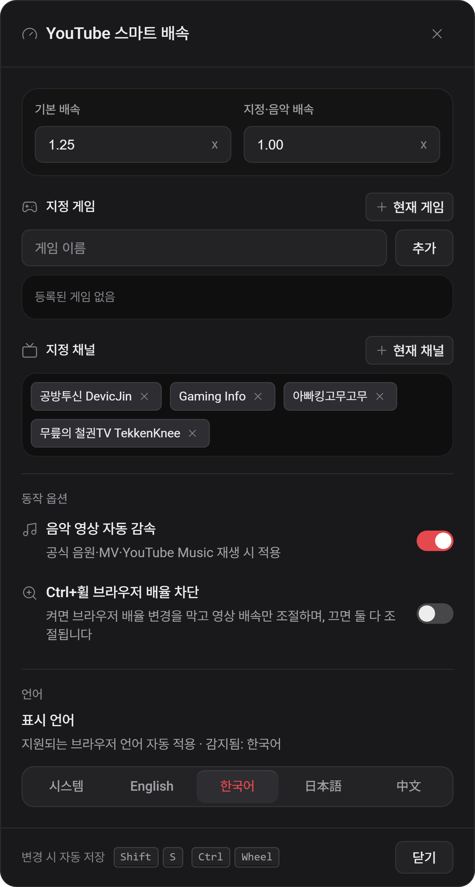

[🇺🇸 English](./README.md) · **🇰🇷 한국어** · [🇯🇵 日本語](./README.ja.md) · [🇨🇳 简体中文](./README.zh-CN.md)

# YouTube 스마트 배속

**YouTube Smart Speed**

채널·게임·음악 조건에 따라 유튜브 재생 배속을 자동으로 전환하고, `Ctrl + 휠` 미세 조절과 선택적 브라우저 배율 차단을 지원하는 유저스크립트입니다.

  
  
  

## 미리보기

  
<strong>플레이어 액션 바 통합 버튼</strong>

  
    
  
<strong>설정 모달 (다크 테마)</strong>

  

## 주요 기능

### 조건별 자동 배속

- **즉시 자동 배속 전환**: 일반 영상은 기본 배속(`1.25x`)으로, 지정한 게임·채널·음악 영상은 지정 배속(`1.00x`)으로 시청 페이지(`/watch`, `/live/*`, `/shorts/*`) 및 YouTube Music에서 대기 시간 없이 즉시 전환합니다.
- **원클릭 게임·채널 등록**: 영상 시청 중 `+ 현재 게임` 또는 `+ 현재 채널` 버튼을 눌러 바로 추가할 수 있으며, 다국어 게임 별칭 매칭(한·영·일·중)과 단어 경계 판별로 오탐을 줄입니다.
- **음악 영상 자동 감속** (`기본값: 켜짐`): YouTube Music, 믹스 재생목록(`list=RD`), 토픽 음원, 공식 아티스트 채널, 음악 카드, 공식 음원·MV(엔터테인먼트 카테고리 포함) 재생 시 자동으로 지정 배속을 적용합니다.

### Ctrl+휠 제어

- **정밀 수동 조절**: 시청 페이지(`/watch`, `/live/*`, `/shorts/*`) 및 YouTube Music에서 `Ctrl` + 마우스 휠로 `0.25x` 단위로 배속을 조절할 수 있으며, 수동 변경은 해당 영상이 바뀔 때까지 유지됩니다.
- **Ctrl+휠 브라우저 배율 차단** (`기본값: 꺼짐`): 기본 꺼짐 상태에서는 `Ctrl + 휠` 시 브라우저 배율과 영상 배속이 함께 조절됩니다. 켜면 브라우저 배율 변경을 막고 영상 배속만 조절합니다.

### 설정 창과 언어

- **플레이어 액션 바의 배속 버튼**(`1.25x`), **확장 프로그램 메뉴의 설정**, 또는 단축키 <kbd>Shift</kbd> + <kbd>S</kbd>로 언제든 설정 창을 열 수 있으며, 변경 내용은 즉시 자동 저장·반영됩니다.
- 유튜브 라이트·다크 테마에 맞춰 색상이 자동으로 바뀌며, 전체화면 상태에서도 모달이 가려지지 않습니다.
- 브라우저 언어에 따라 한국어, 영어, 일본어, 중국어 중 하나가 자동 적용되며(미지원 언어는 영어 기본값), 설정 창 안에서 `시스템`, `English`, `한국어`, `日本語`, `中文`으로 바로 전환할 수 있습니다.

## 설치 방법

1. 브라우저에 [Tampermonkey](https://www.tampermonkey.net/) 또는 [Violentmonkey](https://violentmonkey.github.io/) 확장 프로그램을 설치합니다.
2. 아래 **Install UserScript** 버튼을 눌러 스크립트를 설치합니다:

   

     
   

3. 설치 확인 창이 뜨면 **설치**를 누른 뒤 유튜브 탭을 새로고침합니다.
4. 플레이어 배속 버튼, 확장 프로그램 메뉴의 **설정**, 또는 <kbd>Shift</kbd> + <kbd>S</kbd>로 원하는 옵션을 조절하세요.

수동 설치 및 자동 업데이트 안내

- 원클릭 설치 화면이 자동으로 열리지 않으면 [`youtube-smart-speed.user.js`](./youtube-smart-speed.user.js) 내용을 복사해 스크립트 관리자의 새 스크립트에 붙여넣고 저장하세요.
- 헤더에 `@updateURL`과 `@downloadURL`이 들어 있어 새 버전이 올라오면 확장 프로그램에서 자동으로 업데이트를 확인합니다.

## 단축키

| 동작 | 단축키 |
| --- | --- |
| 설정 창 열기 / 닫기 | <kbd>Shift</kbd> + <kbd>S</kbd> |
| 배속 올리기 / 내리기 (`0.25x` 단위) | <kbd>Ctrl</kbd> + <kbd>Wheel</kbd> |
| 설정 창 닫기 | <kbd>Esc</kbd> |

## 기술 및 호환 참고

- 설정은 `GM_getValue`와 `GM_setValue`(`localStorage` 폴백 포함)에 저장되며, `v1.0.0`의 `localStorage` 설정을 자동으로 이전해 `www.youtube.com`과 `music.youtube.com` 간 설정을 공유합니다.
- `@run-at document-start`로 실행되어 `yt-player-updated`, `yt-navigate-finish` 및 초기 미디어 이벤트에 즉시 반응하며, 현재 영상 ID와 일치하는 `playerResponse`·`watchNext` 메타데이터만 검증해 사용합니다(Firefox XrayWrapper 및 DOM 폴백 지원).
- 설정 저장 시 채널·게임 매처를 사전 컴파일하고 최신 `videoAttributesSectionViewModel`·`horizontalCardListRenderer` 구조를 O(1)로 조회하며, 상시 DOM 옵저버 없이 동작합니다.
- 스타일과 설정 모달을 `innerHTML` 없이 DOM API와 `textContent`만으로 생성해 유튜브의 Trusted Types CSP 환경에서도 차단되지 않습니다.

## 라이선스

[MIT License](./LICENSE)를 따릅니다.
