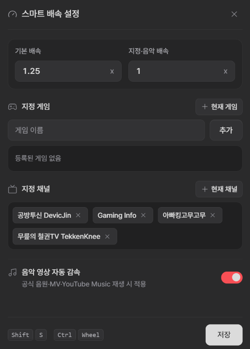

# YouTube Smart Speed

채널·게임·음악 조건에 따라 유튜브 재생 배속을 자동으로 전환하고, 
`Ctrl + 휠`로 미세 조절할 수 있는 다크 테마 유저스크립트입니다.

  
  
  

## 미리보기

  
<strong>플레이어 액션 바 통합 버튼</strong>

  
    
  
<strong>스마트 배속 설정 모달</strong>

  

## 주요 기능

- **조건별 자동 배속 전환**: 일반 영상은 기본 배속(`1.25x`), 지정한 게임·채널·음악 영상은 지정 배속(`1.00x`)으로 자동 전환합니다.
- **원클릭 채널·게임 등록**: 시청 중인 영상에서 `+ 현재 채널` 또는 `+ 현재 게임`을 눌러 바로 목록에 추가할 수 있습니다.
- **음악 영상 자동 감지**: YouTube Music, 공식 음원·MV, 믹스 재생목록(`list=RD`) 재생 시 자동으로 감속합니다.
- **정밀 수동 조절**: `Ctrl` + 마우스 휠로 `0.25x` 단위로 배속을 바꿀 수 있으며, 수동 변경 시 해당 영상이 끝날 때까지 배속이 유지됩니다.
- **유튜브 SPA 라우팅 대응**: 다음 영상 이동이나 뒤로가기 후에도 배속 버튼이 기존 액션 바 규격에 맞춰 그대로 유지됩니다.

> [!TIP]
> 설정 창은 플레이어 우측 액션 바의 원형 배속 버튼(`1.25x`)을 클릭하거나, 키보드에서 <kbd>Shift</kbd> + <kbd>S</kbd>를 눌러 바로 열 수 있습니다.

## 설치 방법

1. 브라우저에 [Tampermonkey](https://www.tampermonkey.net/) 또는 [Violentmonkey](https://violentmonkey.github.io/) 확장 프로그램을 설치합니다.
2. 아래 **Install UserScript** 버튼을 클릭합니다:

   

     
   

3. 확장 프로그램 설치 화면이 열리면 **설치(Install)** 를 누른 뒤 유튜브 탭을 새로고침합니다.

수동 설치 및 업데이트 안내

- 자동 설치 화면이 뜨지 않는 경우, [youtube-smart-speed.user.js](./youtube-smart-speed.user.js) 내용을 복사해 Tampermonkey 대시보드의 **새 스크립트 만들기**에 붙여넣고 저장하세요.
- `@updateURL` 및 `@downloadURL`이 설정되어 있어, 이후 버전이 올라가면 확장 프로그램에서 자동으로 업데이트를 확인할 수 있습니다.

## 단축키

| 동작 | 단축키 |
| --- | --- |
| 설정 창 열기 / 닫기 | <kbd>Shift</kbd> + <kbd>S</kbd> |
| 배속 올리기 / 내리기 (`0.25x` 단위) | <kbd>Ctrl</kbd> + <kbd>Wheel</kbd> |
| 설정 창 닫기 | <kbd>Esc</kbd> |

## 라이선스

[MIT License](./LICENSE)를 따릅니다.
