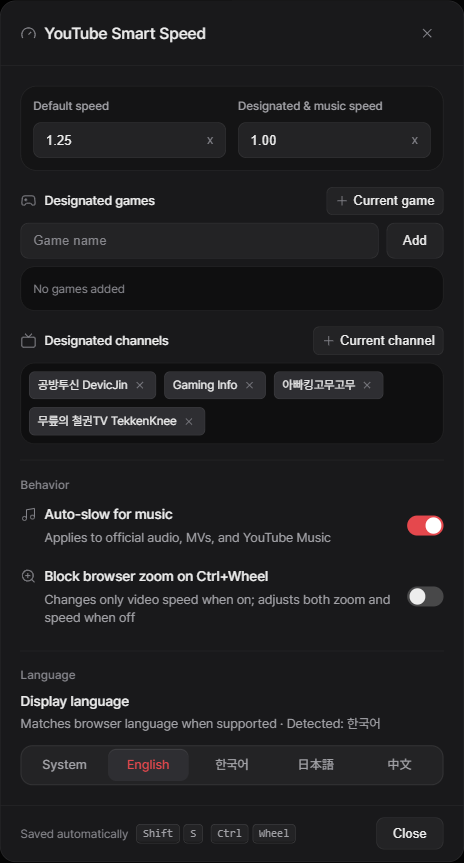

**🇺🇸 English** · [🇰🇷 한국어](./README.ko.md) · [🇯🇵 日本語](./README.ja.md) · [🇨🇳 简体中文](./README.zh-CN.md)

# YouTube Smart Speed

A userscript that automatically switches YouTube playback speed by channel, game, and music, with `Ctrl + Wheel` fine control and optional browser zoom blocking.

  
  
  

## Preview

  
<strong>Player Action Bar Button</strong>

  
    
  
<strong>Settings Modal (Dark Theme)</strong>

  

## Features

### Smart Speed Rules

- **Conditional speed switching**: Uses your default speed (`1.25x` by default) for regular videos and automatically switches to your designated speed (`1.00x` by default) for registered games, channels, or music.
- **One-click channel & game registration**: Click `+ Current game` or `+ Current channel` while watching a video to add it immediately.
- **Auto-slow for music** (`Default: ON`): Automatically applies the slow speed on YouTube Music, official music videos/tracks, and Mix playlists (`list=RD`).

### Ctrl+Wheel Control

- **Fine manual adjustment**: Scroll with `Ctrl + Wheel` on watch, live, Shorts, and YouTube Music pages to step playback speed by `0.25x`. Manual changes stay active until the video changes.
- **Block browser zoom on Ctrl+Wheel** (`Default: OFF`): When off, both browser zoom and video speed adjust together. Turn it on to block browser zoom so `Ctrl + Wheel` changes only video playback speed.

### Settings & Language

- Open settings from the **player action bar button** (`1.25x`), the **Settings** command in your userscript manager menu, or <kbd>Shift</kbd> + <kbd>S</kbd>. All changes save and apply automatically.
- Matches YouTube's light and dark themes automatically and stays visible inside fullscreen.
- Picks English, Korean, Japanese, or Chinese from your browser language (defaulting to English for other languages), with live switching between `System`, `English`, `한국어`, `日本語`, and `中文`.

## Installation

1. Install [Tampermonkey](https://www.tampermonkey.net/) or [Violentmonkey](https://violentmonkey.github.io/) in your browser.
2. Click **Install UserScript** below and confirm the prompt:

   

     
   

3. Reload YouTube, then open **Settings** from the action bar button, your extension menu, or <kbd>Shift</kbd> + <kbd>S</kbd>.

Manual installation and updates

- If the one-click install prompt does not open, copy [`youtube-smart-speed.user.js`](./youtube-smart-speed.user.js) and paste it into a new script in your userscript manager.
- Updates are handled automatically through `@updateURL` and `@downloadURL`.

## Shortcuts

| Action | Shortcut |
| --- | --- |
| Open / close settings | <kbd>Shift</kbd> + <kbd>S</kbd> |
| Increase / decrease speed (`0.25x` step) | <kbd>Ctrl</kbd> + <kbd>Wheel</kbd> |
| Close settings | <kbd>Esc</kbd> |

## Technical & Compatibility Notes

- Stores preferences via `GM_getValue` and `GM_setValue` (with `localStorage` fallback) and migrates `v1.0.0` `localStorage` data automatically, sharing settings between `www.youtube.com` and `music.youtube.com`.
- Uses `unsafeWindow` to read player response metadata and update `setPlaybackRate` cleanly while registering the **Settings** menu command via `GM_registerMenuCommand`.
- Tracks YouTube SPA navigation (`yt-navigate-finish`, `yt-page-data-updated`, `popstate`) to re-apply rules per video and keep the action-bar button mounted, and mounts the modal inside `fullscreenElement` when fullscreen is active.
- Builds styles and UI elements exclusively with DOM APIs and `textContent` without `innerHTML`, complying with YouTube's Trusted Types CSP.

## License

Released under the [MIT License](./LICENSE).
