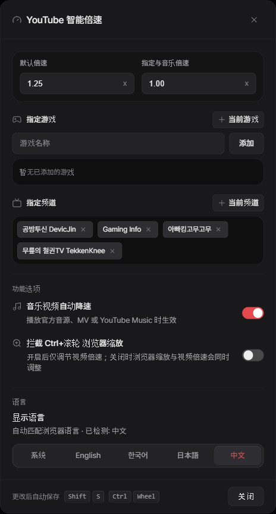

[🇺🇸 English](./README.md) · [🇰🇷 한국어](./README.ko.md) · [🇯🇵 日本語](./README.ja.md) · **🇨🇳 简体中文**

# YouTube 智能倍速

**YouTube Smart Speed**

根据频道、游戏和音乐条件自动切换 YouTube 播放倍速，并支持 `Ctrl + 滚轮` 微调及可选拦截浏览器缩放的用户脚本。

  
  
  

## 预览

  
<strong>播放器操作栏集成按钮</strong>

  
    
  
<strong>设置弹窗（深色主题）</strong>

  

## 功能特性

### 智能倍速规则

- **即时按条件切换倍速**: 普通视频使用默认倍速（默认 `1.25x`），已添加的游戏、频道或音乐视频在播放页（`/watch`、`/live/*`、`/shorts/*`）及 YouTube Music 中无需等待即可即时切换为指定倍速（默认 `1.00x`）。
- **一键添加频道与游戏**: 观看视频时直接点击 `+ 当前游戏` 或 `+ 当前频道` 即可加入列表，内置中·英·韩·日多语言游戏别名与词边界校验，减少误识别。
- **音乐视频自动降速** (`默认开启`): 播放 YouTube Music、混合播放列表（`list=RD`）、Topic 音源、官方音乐人频道、音乐卡片以及官方音源/MV（含娱乐分类）时自动应用指定倍速。

### Ctrl+滚轮控制

- **精细手动调节**: 在播放页（`/watch`、`/live/*`、`/shorts/*`）及 YouTube Music 中按住 `Ctrl` 滚动滚轮，即可以 `0.25x` 为步进微调倍速；手动调整后在当前视频结束或切换前会保持生效。
- **拦截 Ctrl+滚轮 浏览器缩放** (`默认关闭`): 默认关闭时，`Ctrl + 滚轮` 会同时调整浏览器缩放与视频倍速；开启后会拦截浏览器页面缩放，仅调整视频倍速。

### 设置界面与语言

- 可通过**播放器操作栏倍速按钮**（`1.25x`）、**扩展菜单中的“设置”**或快捷键 <kbd>Shift</kbd> + <kbd>S</kbd> 随时打开设置弹窗，所有更改会立即保存并生效。
- 自动适配 YouTube 的浅色与深色主题，在全屏模式下也能正常显示弹窗。
- 根据浏览器语言自动切换中文、英语、韩语或日语（其他语言默认使用英语），也可在弹窗内实时切换 `系统`、`English`、`한국어`、`日本語`、`中文`。

## 安装方法

1. 在浏览器中安装 [Tampermonkey](https://www.tampermonkey.net/) 或 [Violentmonkey](https://violentmonkey.github.io/)。
2. 点击下方的 **Install UserScript** 按钮安装脚本：

   

     
   

3. 在弹出的安装确认页面点击 **安装**，随后刷新 YouTube 页面即可使用。
4. 点击操作栏倍速按钮、扩展菜单中的 **设置**，或按 <kbd>Shift</kbd> + <kbd>S</kbd> 按需调整各项选项。

手动安装与自动更新说明

- 如果一键安装窗口未自动弹出，可复制 [`youtube-smart-speed.user.js`](./youtube-smart-speed.user.js) 的全部内容，在脚本管理器中新建脚本并粘贴保存。
- 脚本头部已配置 `@updateURL` 与 `@downloadURL`，后续发布新版本时扩展会自动检查更新。

## 快捷键

| 操作 | 快捷键 |
| --- | --- |
| 打开 / 关闭设置 | <kbd>Shift</kbd> + <kbd>S</kbd> |
| 提高 / 降低倍速（`0.25x` 步进） | <kbd>Ctrl</kbd> + <kbd>Wheel</kbd> |
| 关闭设置弹窗 | <kbd>Esc</kbd> |

## 技术与兼容性说明

- 使用 `GM_getValue` 和 `GM_setValue` 保存配置（支持 `localStorage` 回退），并会自动迁移 `v1.0.0` 的 `localStorage` 数据，在 `www.youtube.com` 与 `music.youtube.com` 之间共享设置。
- 在 `@run-at document-start` 阶段注入并即时响应 `yt-player-updated`、`yt-navigate-finish` 与早期媒体事件，仅采信匹配当前视频 ID 的 `playerResponse` 与 `watchNext` 元数据（兼容 Firefox XrayWrapper 与 DOM 回退）。
- 保存设置时预编译频道/游戏匹配器，无需常驻 DOM 监听器即可直接读取新版 `videoAttributesSectionViewModel` 与 `horizontalCardListRenderer` 数据。
- 样式与设置界面全部采用原生 DOM API 和 `textContent` 构建，不使用 `innerHTML`，可正常通过 YouTube 的 Trusted Types CSP 校验。

## 开源协议

基于 [MIT License](./LICENSE) 发布。
